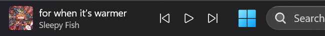
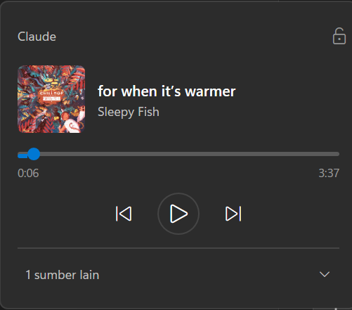
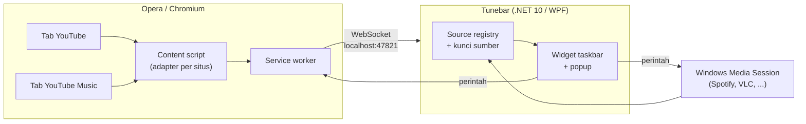

<div align="center">

# 🎵 Tunebar

**Kontrol musik langsung dari taskbar Windows 11, tanpa membuka aplikasi yang memutarnya.**

Pause, next, dan prev untuk YouTube, YouTube Music, Spotify, dan aplikasi lain, langsung dari ujung kiri taskbar.




</div>

---

## Kenapa Tunebar?

Musik sering diputar di tab browser yang tertumpuk di antara puluhan tab lain. Untuk sekadar menjeda lagu, kita harus mencari jendela browser, lalu tab-nya, lalu tombol pause.

Windows 11 punya kontrol media bawaan, tapi letaknya di balik panel Quick Settings. Ikon tray juga jatuh ke menu tersembunyi (`^`).

Tunebar menaruh kontrolnya di tempat yang selalu kosong: **ujung kiri taskbar**. Satu klik untuk play/pause, dan satu klik lagi untuk membuka panel lengkap.

<div align="center">



</div>

## Fitur

| | |
|---|---|
| 🎛️ **Widget di taskbar** | Cover, judul, artis, dan tombol ⏮ ⏯ ⏭ menempel di ujung kiri taskbar. Ikut muncul dan sembunyi bersama taskbar auto-hide. |
| 🔍 **Deteksi sumber otomatis** | Tunebar membaca semua yang sedang diputar: tab YouTube/YouTube Music (lewat ekstensi) serta Spotify, VLC, dan aplikasi lain (lewat Windows Media Session). |
| 🔒 **Kunci sumber** | Kunci lagu yang sedang dikontrol supaya tidak berpindah ketika ada video lain yang mulai berbunyi. |
| 🔊 **Volume per sumber** | Atur volume tiap tab atau aplikasi, terpisah dari slider volume YouTube. Untuk tab browser bisa sampai 150%. |
| 📃 **Daftar playlist** | Lihat isi playlist yang sedang diputar dan lompat ke lagu mana pun. Rekomendasi autoplay setelah playlist habis tidak ikut ditampilkan. |
| 🔁 **Satu tombol loop** | Satu tombol untuk berputar antara mati → ulang playlist → ulang satu lagu. |
| ⏩ **Seek** | Geser posisi lagu langsung dari popup. |
| ⌨️ **Hotkey global** | Kontrol sumber yang sedang tampil tanpa mouse: `Ctrl+Alt+Shift` + `Spasi` (play/pause), `→` (berikutnya), `←` (sebelumnya), `↑` / `↓` (volume ±10%). |
| 🌗 **Ikut tema Windows** | Warna terang/gelap mengikuti pengaturan Windows dan warna taskbar. |
| 🚀 **Ringan & jalan otomatis** | Berjalan saat Windows mulai (bisa dimatikan), satu instance, dan hemat memori. |

## Cara kerja



- **Ekstensi browser.** Windows hanya melihat satu sesi media untuk seluruh browser, sehingga tab tidak bisa dibedakan. Ekstensi membaca tiap tab satu per satu: judul, posisi, playlist, dan status loop. Ekstensi juga menjalankan perintah langsung di halaman.
- **Koneksi lokal saja.** Ekstensi dan aplikasi berbicara lewat WebSocket di `localhost`. Server hanya menerima koneksi dari ID ekstensi Tunebar (pengecekan `Origin`).
- **Volume tanpa menyentuh slider YouTube.** Untuk tab, volume diatur dengan `GainNode` Web Audio. Untuk aplikasi lain, Tunebar memakai volume per aplikasi dari Windows (Core Audio).
- **Widget di taskbar.** Widget adalah jendela kecil yang dijadikan *child window* dari taskbar Windows (`Shell_TrayWnd`). Widget tidak mengambil fokus saat diklik, jadi taskbar auto-hide tetap bisa turun seperti biasa.

## Kebutuhan

- Windows 11
- [.NET 10 SDK](https://dotnet.microsoft.com/download) (untuk build) atau .NET 10 Desktop Runtime (untuk menjalankan)
- Opera, Chrome, Edge, atau browser Chromium lain (untuk kontrol per tab)
- Node.js (hanya untuk menjalankan tes ekstensi)

Belum punya .NET? Pasang per-user tanpa hak admin dengan skrip resmi Microsoft:

```powershell
Invoke-WebRequest https://dot.net/v1/dotnet-install.ps1 -OutFile dotnet-install.ps1
.\dotnet-install.ps1 -Channel 10.0 -InstallDir "$env:LOCALAPPDATA\Microsoft\dotnet"
```

## Instalasi

### 1. Build & pasang aplikasi

```powershell
git clone https://github.com/KuzuChis/Tunebar.git
cd Tunebar
dotnet publish src/Tunebar -c Release -r win-x64 --self-contained false -p:PublishSingleFile=true -o publish
New-Item -ItemType Directory -Force "$env:LOCALAPPDATA\Programs\Tunebar" | Out-Null
Copy-Item publish\* "$env:LOCALAPPDATA\Programs\Tunebar" -Force
& "$env:LOCALAPPDATA\Programs\Tunebar\Tunebar.exe"
```

Saat pertama kali dijalankan, Tunebar langsung terdaftar untuk berjalan saat Windows mulai. Pendaftarannya berupa tugas Task Scheduler bernama "Tunebar" (terlihat di Task Scheduler, bukan di tab Startup Task Manager). Menu tray **Jalankan saat Windows mulai** menyalakan atau mematikannya.

Untuk mencoba tanpa memasang:

```powershell
dotnet run --project src/Tunebar
```

### 2. Pasang ekstensi browser

1. Buka `opera://extensions` (atau `chrome://extensions` / `edge://extensions`).
2. Aktifkan **Developer mode**.
3. Klik **Load unpacked**, lalu pilih folder `extension/`.
4. Muat ulang (reload) tab YouTube yang sudah terbuka.

Tanpa ekstensi, Tunebar tetap bisa mengontrol browser lewat Windows Media Session, tapi hanya satu sesi per browser dan tanpa playlist, loop, atau volume per tab.

## Pemakaian

| Aksi | Cara |
|---|---|
| Play / pause, next, prev | Klik ⏯ ⏭ ⏮ di widget taskbar |
| Play / pause dari keyboard | `Ctrl+Alt+Shift+Spasi` |
| Berikutnya / sebelumnya dari keyboard | `Ctrl+Alt+Shift+→` / `Ctrl+Alt+Shift+←` |
| Volume naik / turun 10% dari keyboard | `Ctrl+Alt+Shift+↑` / `Ctrl+Alt+Shift+↓` |
| Buka panel lengkap | Klik cover atau judul di widget (atau klik ikon tray) |
| Kunci sumber | Klik ikon gembok di popup |
| Pindah ke sumber lain | Buka bagian "sumber lain" di popup |
| Sembunyikan widget / matikan auto-start | Klik kanan ikon tray, lalu pilih **Tampilkan di taskbar** / **Jalankan saat Windows mulai** |
| Kembalikan volume tab ke 100% | Klik ikon ekstensi di toolbar browser |

Pengaturan disimpan di `%LOCALAPPDATA%\Tunebar`.

## Struktur project

```
Tunebar/
├── src/Tunebar/
│   ├── Core/        # model sumber, registry + kunci, protokol, format
│   ├── Bridge/      # server WebSocket + validasi Origin
│   ├── Windows/     # Windows Media Session, volume per app, taskbar, auto-start
│   └── Ui/          # widget taskbar, popup, tema
├── tests/Tunebar.Tests/   # unit test xUnit
├── extension/             # ekstensi Chromium MV3 (service worker, content script, adapter situs)
└── docs/                  # desain & rencana
```

## Tes

```powershell
dotnet test Tunebar.sln
node --test "extension/tests/*.test.mjs"
```

## Batasan yang diketahui

- Widget hanya muncul di taskbar bawah monitor utama, dengan ikon rata tengah dan tombol Widgets dimatikan. Kalau tidak, kontrol tetap tersedia lewat ikon tray.
- Adapter per situs saat ini hanya untuk YouTube dan YouTube Music. Situs lain tetap bisa di-play/pause lewat Windows Media Session.
- Setelah ekstensi di-reload atau diperbarui, tab yang sudah terbuka perlu dimuat ulang agar tersambung kembali.
- Gambar sampul dimuat dari server gambar YouTube, jadi butuh koneksi internet.

## Teknologi

C# · .NET 10 · WPF · [H.NotifyIcon](https://github.com/HavenDV/H.NotifyIcon) · [NAudio](https://github.com/naudio/NAudio) · Windows Media Control API · UI Automation · JavaScript (Chromium Manifest V3) · xUnit · Node test runner

<div align="center">

Dibuat dengan ☕ oleh [KuzuChis](https://github.com/KuzuChis)

</div>
